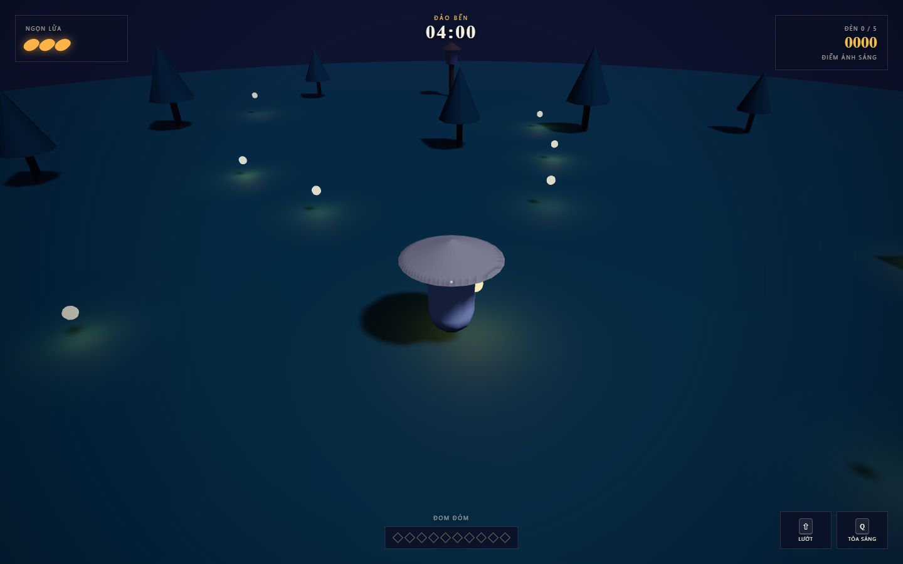
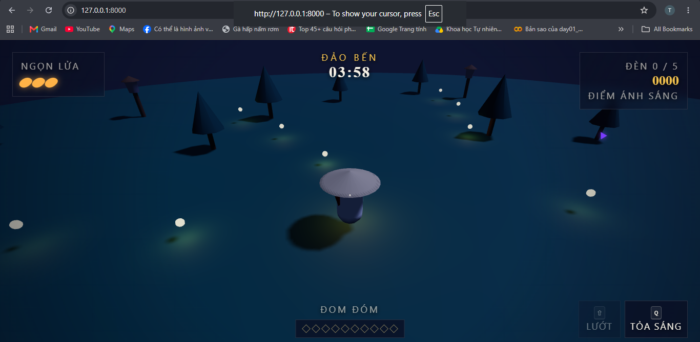

# Demo

## Video (bắt buộc theo Ticket-04)

File: [`demo.mp4`](demo.mp4) (~30 giây, dưới 5 phút).

Nội dung:

1. Ảnh menu + gameplay đã chụp tay.
2. Đoạn capture headless Chrome CDP khi game `autostart` trên `http://127.0.0.1:8000`.

Tạo lại:

```bash
python -m lantern_islands.webapp
# terminal khác:
set PYTHONPATH=.
python scripts/make_demo_mp4.py
```

Đính kèm thêm vào GitHub Release `v1.0.0` nếu cần tải độc lập.

## Ảnh





## Bằng chứng kèm theo

```bash
python scripts/verify.py
python -m lantern_islands.benchmark --seed 42 --duration 30 --out bench.json
python -m lantern_islands.soak --seed 7 --nights 10 --out soak.json
```
